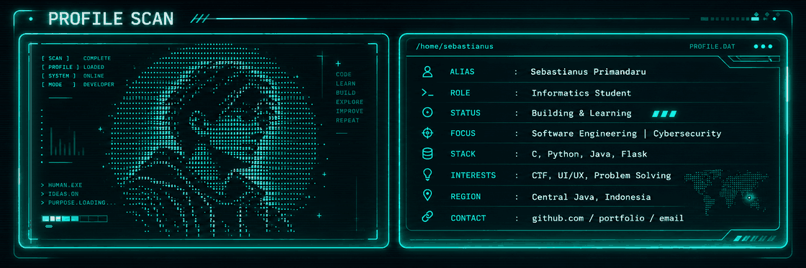

<!--
  PROFILE SCAN / GITHUB README
  Theme: CYBER TERMINAL  |  Neon Cyan  |  Minimal HUD

  QUICK SETUP
  1. Replace YOUR_USERNAME and YOUR_EMAIL@example.com below.
  2. Upload this README.md together with the assets/ folder.
  3. Create a PUBLIC repository named exactly like your GitHub username.
  4. Read SETUP.md for full instructions.
-->

<div align="center">
  <p align="center">
    
  </p>
  <a href="https://github.com/YOUR_USERNAME">
    
  </a>
  <br />
  <samp>◈ SYSTEM ONLINE &nbsp;·&nbsp; BUILDING IN PUBLIC &nbsp;·&nbsp; ALWAYS LEARNING ◈</samp>
  <br /><br />
  <a href="https://github.com/YOUR_USERNAME?tab=repositories">Repositories</a>
  &nbsp;&nbsp; / &nbsp;&nbsp;
  <a href="https://github.com/YOUR_USERNAME?tab=stars">Starred Projects</a>
  &nbsp;&nbsp; / &nbsp;&nbsp;
  <a href="mailto:YOUR_EMAIL@example.com">Email</a>
</div>

<br />

### `01 / WHOAMI`

> **I build with curiosity, debug with patience, and learn by exploring how things work beneath the surface.**

I'm **Sebastianus Primandaru**, an Informatics student interested in turning complex problems into thoughtful, usable software. My playground moves between **software engineering**, **cybersecurity / CTF**, and **interface design**.

```text
┌──(visitor㉿profile)-[~]
└─$ cat identity.log

  ROLE       : Informatics Student
  FOCUS      : Software Engineering / Cybersecurity
  SIDE QUEST : CTF, OSINT, Digital Forensics, UI/UX
  MINDSET    : Build. Break down. Understand. Improve.
  STATUS     : Learning in public  [● ACTIVE]
```

### `02 / THE TOOLKIT`

| Layer | Things I work with |
| :--- | :--- |
| **Languages** | `Python` · `Java` · `C` · `PHP` · `JavaScript` · `SQL` |
| **Web & UI** | `HTML` · `CSS` · `Flask` · `Responsive Design` |
| **Data & Apps** | `MySQL` · `Java Swing` · `REST API` · `MVC` |
| **Security & Tools** | `Linux` · `Git` · `Wireshark` · `OSINT` · `Digital Forensics` |
| **Exploring next** | `Machine Learning` · `Web Security` · `Creative Frontend` |

### `03 / SELECTED BUILDS`

<table>
  <tr>
    <td width="50%" valign="top">
      <h3>◈ Reservation Platform</h3>
      <code>Flask · Python · HTML/CSS/JS</code>
      <p>Authentication, booking flows, account management, and an admin dashboard for reservation operations.</p>
    </td>
    <td width="50%" valign="top">
      <h3>◈ Library Management System</h3>
      <code>Java Swing · MVC · SQL</code>
      <p>A desktop library application with member/admin roles, book management, borrowing, and returns.</p>
    </td>
  </tr>
  <tr>
    <td width="50%" valign="top">
      <h3>◈ Marketing Management</h3>
      <code>Web Application · Multi-role Design</code>
      <p>A role-based workflow for assigning marketing activities, reporting progress, and reviewing operations.</p>
    </td>
    <td width="50%" valign="top">
      <h3>◈ CTF & Security Lab</h3>
      <code>OSINT · Forensics · Web Security</code>
      <p>Learning through investigation, packet analysis, file artifacts, and hands-on security puzzles.</p>
    </td>
  </tr>
</table>

<sub>Projects above describe areas of work and exploration; add links to public repositories once published.</sub>

<p align="right">
  <a href="https://github.com/YOUR_USERNAME?tab=repositories"><b>EXPLORE REPOSITORIES →</b></a>
</p>

### `04 / CURRENT MISSION`

```text
[████████████░░░░]  learning new things
[██████████████░░]  building better software
[████████████████]  staying curious

> next objective: ship something useful.
> _
```

<details>
  <summary><b>▸ Open a hidden terminal</b></summary>
  <br />

  ```console
  $ ./developer.sh --philosophy

  [OK] Read the docs.
  [OK] Test the assumptions.
  [OK] Keep the UI human.
  [OK] Never stop learning.

  ACCESS GRANTED: curiosity is the only requirement.
  ```
</details>

<br />

<div align="center">
  <samp>┌────────────────────────────────────────────┐</samp><br />
  <samp>NO MAGIC. JUST CURIOSITY, CODE & CONSISTENCY.</samp><br />
  <samp>└────────────────────────────────────────────┘</samp><br /><br />
  <sub>Designed like a terminal · Built to keep evolving</sub>
</div>
